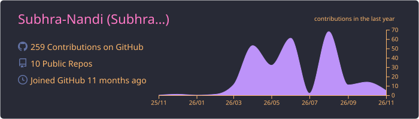
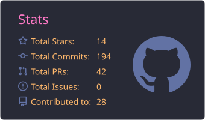
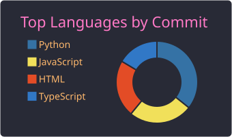
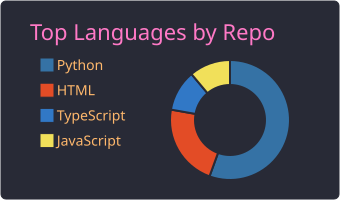
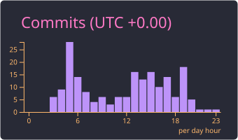

## About Me

I'm a third-year B.Tech student in **AI & Robotics** at the University of Engineering and Management, Kolkata (GPA 8.17, graduating 2028). I build software where AI meets systems engineering: LLM infrastructure, retrieval pipelines, agentic workflows and geospatial applications.

I care most about the engineering around the model. That means concurrency and correctness (atomic Redis operations, row-level locking, async pipelines), performance work backed by real measurements, and deterministic safeguards that keep probabilistic models away from decisions they shouldn't make on their own. Most of my experience comes from open source and hackathons, where I've learned to ship working systems under real constraints.

Away from the keyboard, you'll usually find me on a badminton court.

## Get in Touch

I'm open to internships, open-source collaboration and hackathon teams. Email is the fastest way to reach me.

  
  
  

## Progress Log

| Track | Where I am | Next milestone |
|:--|:--|:--|
| **Open Source** | Merged PRs in `hushh-labs/hushh-research`, peaking at **weekly rank #8 of ~5–6k contributors**; took part in **GSSoC '26** | **GSoC 2027** |
| **DSA** | **300+ LeetCode** problems in C++, currently in the DP phase | Finish DP, then move to Codeforces |
| **Codeforces** | Started as a beginner | **Expert (1600) by Jan 31, 2027**, Master long-term |
| **CodeChef** | Just getting started | **4★ by end of Jan 2027** |
| **Full-stack** | Next.js + FastAPI in production projects; MERN sprint underway | SDE / full-stack internship |
| **Hackathons** | Razorpay Buildathon · Hack2Skill · AWS Bharat Builds · Amazon ML Challenge · SIH 2026 (THERMIS) | Keep shipping |

<b>Roadmap checklist</b>

 

- [x] First RAG project (Tesla 10-K chatbot)
- [x] Deployed a production-style LLM proxy (LLM-Shield)
- [x] Merged PRs into a large open-source codebase (hushh-research)
- [x] GirlScript Summer of Code '26
- [x] 300+ LeetCode problems
- [x] Portfolio site live
- [ ] Finish the LeetCode DP phase
- [ ] Codeforces Expert (1600)
- [ ] CodeChef 4★
- [ ] Finish the MERN sprint
- [ ] GSoC 2027

## Featured Work

<table>
<tr>
<td width="50%" valign="top">

### [APEX-Commerce](https://github.com/Subhra-Nandi/apex-commerce)
Razorpay Buildathon · Agentic Commerce

Middleware between autonomous AI buyer agents and merchants: machine-readable catalogs, margin-aware negotiation, and a **deterministic policy enclave**. *The AI proposes the price; non-LLM code decides whether it can be charged.*

`Next.js 15` `FastAPI` `Claude` `Gemini` `Neon Postgres`

</td>
<td width="50%" valign="top">

### [PIVOT](https://github.com/Subhra-Nandi/PIVOT)
Hack2Skill · Industrial Commerce · Team DevCore

Turns messy supplier PDFs and listings into commerce-ready product data. Every field is **cited, grounded and conflict-checked**, with a 4-provider LLM fallback chain and **228 passing tests**.

`FastAPI` `React + Vite` `OpenRouter` `Railway` · [**Live demo**](https://pivot-seven-eta.vercel.app/)

</td>
</tr>
<tr>
<td width="50%" valign="top">

### [LLM-Shield](https://github.com/Subhra-Nandi/llm-shield)
LLM infrastructure

A drop-in, OpenAI-compatible proxy with a semantic cache, PII redaction, two-stage prompt-injection detection (regex in under 1 ms, then DeBERTa-v3), token-bucket rate limiting, failover and Prometheus metrics.

`FastAPI` `Redis` `Presidio` `Postgres` `Docker` · [**Live demo**](https://llm-shield-five.vercel.app)

</td>
<td width="50%" valign="top">

### [NGO Resource Allocation](https://github.com/Subhra-Nandi/ngo-resource-allocation-system)
Disaster response · Geospatial AI

Connects people in crisis to the nearest NGO with stock available. Takes text, voice or photo requests through AI validation gates, uses **PostGIS** for nearest-depot search, and **row-level locking** to prevent double dispatch.

`FastAPI` `Next.js 14` `PostGIS` `GPT-4o`

</td>
</tr>
<tr>
<td width="50%" valign="top">

### [AIRA](https://github.com/Subhra-Nandi/aira-platform)
Multi-agent research platform

Research, Analysis and Coding agents work from a single prompt. They search the live web and return startup ideas, market insights or working code tailored to a founder profile.

`FastAPI` `Pydantic` `LLM agents` `n8n`

</td>
<td width="50%" valign="top">

### [Vaani](https://github.com/Subhra-Nandi/vaani)
Voice AI

A Hindi voice assistant for re-engaging students. Whisper STT → state-machine dialogue → LLM objection handling → Coqui TTS, with Redis session memory.

`Whisper` `Coqui TTS` `Ollama` `Redis` `FastAPI`

</td>
</tr>
<tr>
<td width="50%" valign="top">

### [Light-Seeking Car](https://github.com/Subhra-Nandi/light-seeking-car)
Robotics

Colour and light detection on a **Jetson** sends commands over serial to an **Arduino** that drives the car.

`Python` `Jetson` `Arduino` `C++`

</td>
<td width="50%" valign="top">

### [Tesla 10-K RAG](https://github.com/Subhra-Nandi/tesla-rag)
Where it all started

My first project: a RAG chatbot over Tesla's 10-K report, using embeddings search, retrieved context and Gemini answers.

`LangChain` `Pinecone` `Gemini` `HuggingFace`

</td>
</tr>
</table>

## Tech Stack

**Languages** 

**Backend · Frontend · Data** 

**ML · Robotics · DevOps** 

**AI tooling** 

## GitHub Stats

<!-- Generated every 12 hours by .github/workflows/profile-cards.yml -->

<i>Build systems that think, scale, and solve.</i>

